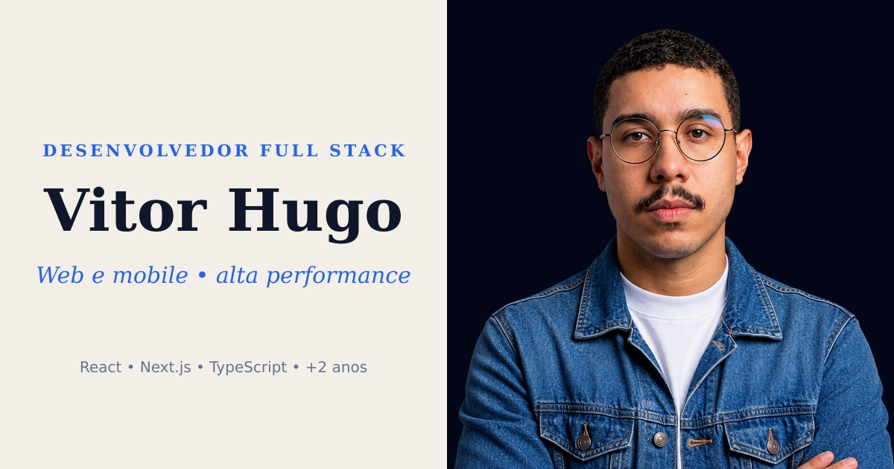

<div align="center">



# 💼 Portfólio — Vítor H. Cesar

Meu portfólio profissional como Desenvolvedor Full Stack: apresentação, projetos com galeria de screenshots, depoimentos e formulário de contato.

     

**[🌐 Ver ao vivo](https://portfolio.vitorhcesar.com.br)**

</div>

## ✨ Funcionalidades

- **Seções:** Hero (stack e experiência), Sobre (bio, formação, linha do tempo e valores), Projetos, Depoimentos e Contato
- **Galeria de projetos** com screenshots em carrossel e lightbox
- **Formulário de contato** validado com Zod, enviado por e-mail via SMTP (Nodemailer) na rota `/api/contact`, com rate limit em memória
- **Opção de contato por WhatsApp**, quando `VITE_WHATSAPP_NUMBER` está definido
- **Modo currículo** (`VITE_CURRICULUM_MODE` / `CURRICULUM_MODE`): oculta contato, redes sociais, currículo em PDF e formulário
- **Currículo em PDF** em português e inglês
- **SEO:** canonical, Open Graph, JSON-LD, `robots.txt` e `sitemap.xml` gerados por rota
- **Splash screen**, animações de scroll e imagens otimizadas (WebP)
- Script para gerar a imagem Open Graph (`bun run generate:og`)

## 🛠️ Stack

- **Framework:** TanStack Start (React + TanStack Router, SSR com Nitro)
- **Linguagem:** TypeScript
- **Estilo:** Tailwind CSS v4, Lucide Icons
- **Validação e e-mail:** Zod, Nodemailer
- **Build e runtime:** Vite, Bun
- **Qualidade:** ESLint, Prettier, React Compiler

## 📁 Estrutura

```
src/
├── components/   # sections/ (Hero, About, Projects, Testimonials, Contact), layout, ui, splash
├── hooks/        # scroll reveal, seção ativa, carrossel de screenshots
├── lib/          # conteúdo (projetos, sobre, depoimentos), SEO, SMTP, rate limit, modo currículo
└── routes/       # página inicial, 404, api/contact, robots.txt e sitemap.xml
public/           # imagens, ícones de tecnologias e currículos em PDF
scripts/          # geração de imagens (Open Graph)
```

## 🚀 Como rodar

```bash
bun install
cp .env.example .env   # preencha as variáveis
bun --bun run dev      # http://localhost:3000
```

| Script | O que faz |
|---|---|
| `dev` | Servidor de desenvolvimento na porta 3000 |
| `build` | Build de produção |
| `preview` | Pré-visualiza o build |
| `generate:og` | Gera a imagem Open Graph |
| `generate-routes` | Gera a árvore de rotas do TanStack Router |
| `lint` / `format` / `check` | ESLint e Prettier |

## 🔐 Variáveis de ambiente

Veja `.env.example`. Nunca versione valores reais.

| Variável | Uso |
|---|---|
| `VITE_SITE_URL` | URL pública (canonical, Open Graph, sitemap, JSON-LD) |
| `VITE_CURRICULUM_MODE` / `CURRICULUM_MODE` | Liga o modo currículo (cliente / servidor) |
| `VITE_CONTACT_EMAIL` | E-mail exibido na seção Contato (opcional) |
| `VITE_WHATSAPP_NUMBER` | Contato via WhatsApp (opcional) |
| `VITE_LINKEDIN_URL` | Perfil do LinkedIn no JSON-LD (opcional) |
| `SMTP_HOST`, `SMTP_PORT`, `SMTP_USERNAME`, `SMTP_PASSWORD`, `SMTP_FROM`, `SMTP_SECURE` | Envio de e-mail (somente servidor) |
| `CONTACT_TO_EMAIL` | Caixa que recebe as mensagens do formulário |

## 📄 Licença

O código é público para consulta. Veja os termos em [LICENSE](LICENSE).

## 👤 Autor

Feito por **Vítor H. Cesar**, Desenvolvedor Full Stack.

[](https://www.linkedin.com/in/vitorhcesar/) [](https://github.com/vitorhcesar)
